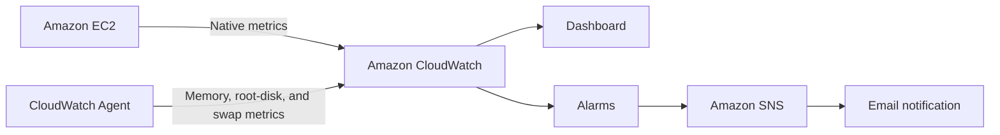

# AWS Cloud Monitoring Lab

Portfolio‑ready AWS observability case study using Amazon CloudWatch Agent, CloudWatch dashboards and alarms, and Amazon SNS email notifications.

> Educational, non‑commercial project. No account IDs, ARNs, email addresses, IP addresses, credentials, or unredacted console exports are tracked.

## Overview

This repository turns a practical EC2 observability task into reproducible, reviewable infrastructure documentation rather than leaving it as undocumented console configuration.

## Demonstrated capabilities

- EC2 infrastructure and guest operating‑system monitoring
- CloudWatch Agent configuration for memory, root-disk, and swap utilization
- CloudWatch dashboards combining `AWS/EC2` and `CWAgent` metrics
- CPU, memory, and root-disk alarms
- Amazon SNS email notification workflow
- Cost‑aware operations, least‑privilege, and evidence redaction

## Scope

| This is | This is not |
| --- | --- |
| A reproducible single‑instance monitoring case study | A claim of a production-scale monitoring platform |
| A documented CloudWatch Agent, dashboard, alarm, and SNS workflow | An on-call or incident-management system |

## Architecture



## Evidence

The repository combines version-controlled configuration with redacted evidence from the running lab. It includes dashboard and Agent telemetry, alarm state, confirmed SNS subscription, and a controlled CloudWatch-to-SNS delivery test.

See the [evidence gallery](docs/evidence-and-screenshots.md), [live verification record](docs/live-verification.md), [metric catalog](docs/metric-catalog.md), [decision log](docs/decision-log.md), [troubleshooting guide](docs/troubleshooting.md), and [maintenance and cleanup runbook](docs/maintenance-and-cleanup.md).

## Repository layout

```text
config/          CloudWatch Agent configuration
dashboards/      Dashboard template and export workflow
infrastructure/  CloudFormation alarms
scripts/         Validation and deployment helpers
docs/            Architecture, decisions, verification, security, cost, and runbook notes
screenshots/     Redacted live evidence
```

## Quick start

```bash
# Validate local JSON configuration and check the alarm template
bash scripts/validate-config.sh

# Render and validate a dashboard without contacting AWS
./scripts/deploy-dashboard.sh --dry-run ec2-monitoring-dashboard <instance-id> <region>

# Deploy a dashboard (replace placeholders with your values)
./scripts/deploy-dashboard.sh ec2-monitoring-dashboard <instance-id> <region>
```

Create and confirm an SNS subscription, install the CloudWatch Agent, then deploy [`infrastructure/cloudwatch-alarms.yaml`](infrastructure/cloudwatch-alarms.yaml) as described in the setup guide. Do not put resource identifiers in Git‑tracked files.

For the implementation rationale, see the [cost optimization case study](docs/cost-optimization-case-study.md), [metric catalog](docs/metric-catalog.md), and [decision log](docs/decision-log.md).

For an opt-in CloudWatch Logs extension, see [optional logs integration](docs/optional-cloudwatch-logs.md). Enable it only after log paths, retention, and privacy needs have been reviewed.

## Verification path

1. Confirm EC2 metrics appear under `AWS/EC2`.
2. Confirm `mem_used_percent`, `disk_used_percent`, and `swap_used_percent` appear under `CWAgent`.
3. Confirm CloudWatch alarms leave `INSUFFICIENT_DATA` and become `OK`.
4. Confirm the SNS email subscription, then run a documented controlled test before treating notifications as delivered.
5. Add the redacted evidence images specified in the [evidence guide](docs/evidence-and-screenshots.md).

## Redacted live dashboard evidence

The live CloudWatch dashboard is captured across three time windows. Account identifiers are excluded; the images show unmodified console views.


See the [full evidence gallery](docs/evidence-and-screenshots.md) for one-day, one-week, and post-change views.

## How this project can grow

- Add CloudWatch Logs with explicit retention and a documented log‑selection rationale.
- Manage the instance role, SNS topic, dashboard, and alarms fully through infrastructure as code.
- Add AWS Budgets and Cost Anomaly Detection as a separate cost‑observability layer.

## Prerequisites

| Tool | Minimum version |
|------|-----------------|
| AWS CLI | 2.0 |
| jq | 1.6 |
| Bash (macOS / Linux) | any recent version |

---

[](https://github.com/Faruktahsin/aws-cloud-monitoring-lab/actions/workflows/validate.yml)
