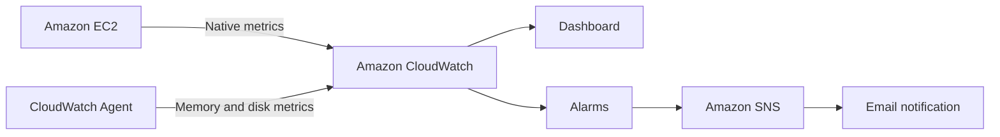

# AWS Cloud Monitoring Lab

Portfolio-ready AWS observability case study using Amazon CloudWatch Agent, CloudWatch dashboards and alarms, and Amazon SNS email notifications.

> Educational, non-commercial project. No account IDs, ARNs, email addresses, IP addresses, credentials, or unredacted console exports are tracked.

## Why this repository exists

Not every cloud engineering project needs an application. This repository documents a practical operations task: making an EC2 workload observable, defining the alerting path, and making the work reproducible instead of leaving it as undocumented console clicks.

It is intended for recruiters, hiring managers, and engineers who want to see how I approach cloud monitoring, operational boundaries, and infrastructure documentation.

## Demonstrated capabilities

- EC2 infrastructure and guest operating-system monitoring
- CloudWatch Agent configuration for memory and disk utilization
- CloudWatch dashboards combining `AWS/EC2` and `CWAgent` metrics
- CPU, status-check, memory, and disk alarms
- Amazon SNS email notification workflow
- Cost-aware operations, least privilege, and evidence redaction

## What this is—and is not

| This is | This is not |
| --- | --- |
| A reproducible single-instance monitoring lab and portfolio case study | A claim of a production-scale monitoring platform |
| A documented CloudWatch Agent, dashboard, alarm, and SNS workflow | A substitute for an on-call process or incident-management system |
| A transparent record of configuration and validation steps | A repository containing private AWS account data or credentials |

## Architecture



## Live evidence model

Git cannot host live AWS resources. This repository shows the work through:

1. version-controlled configuration and infrastructure templates;
2. sanitized dashboard definitions; and
3. redacted screenshots that prove the running resources.

See [setup](docs/setup-guide.md), [evidence guidance](docs/evidence-and-screenshots.md), and [the publishing checklist](docs/github-publishing-checklist.md).

## Evidence maturity

| Level | Meaning | Publicly tracked now |
| --- | --- | --- |
| Configuration | Agent JSON, dashboard template, and CloudFormation alarm definition | Yes |
| Local validation | JSON and repository configuration checks | Yes |
| Live verification | Redacted dashboard, metrics, alarm state, and confirmed SNS evidence | Add after AWS-console review |

This distinction is intentional: templates prove design and repeatability; redacted live evidence proves the lab was actually exercised.

## Repository layout

```text
config/          CloudWatch Agent configuration
dashboards/      Dashboard template and export workflow
infrastructure/  CloudFormation alarms
scripts/         Validation and deployment helpers
docs/            Architecture, setup, security, cost, and runbook notes
screenshots/     Redacted live evidence placeholders
```

## Quick start

```bash
bash scripts/validate-config.sh
./scripts/deploy-dashboard.sh ec2-monitoring-dashboard <instance-id> <region>
```

Create and confirm an SNS subscription, install the CloudWatch Agent, then deploy [`infrastructure/cloudwatch-alarms.yaml`](infrastructure/cloudwatch-alarms.yaml) as described in the setup guide. Do not put resource identifiers in Git-tracked files.

## Verification path

1. Confirm EC2 metrics appear under `AWS/EC2`.
2. Confirm `mem_used_percent` and `disk_used_percent` appear under `CWAgent`.
3. Confirm CloudWatch alarms leave `INSUFFICIENT_DATA` and become `OK`.
4. Confirm the SNS email subscription before treating notifications as working.
5. Add the four redacted images specified in the [evidence guide](docs/evidence-and-screenshots.md).

## How this project can grow

- Add CloudWatch Logs with explicit retention and a documented log-selection rationale.
- Manage the instance role, SNS topic, dashboard, and alarms fully through infrastructure as code.
- Add AWS Budgets and Cost Anomaly Detection as a separate cost-observability layer.
- Add a small incident timeline or post-incident template after a controlled alarm test.
- Add automated template checks through GitHub Actions; this repository already includes a lightweight validation workflow.

## CV-ready description

> Built an AWS EC2 monitoring lab using Amazon CloudWatch Agent, CloudWatch dashboards and alarms, and Amazon SNS email notifications. Implemented host-level memory/disk telemetry, health and capacity alerts, reproducible configuration, and documented cost and security controls.

## Current status

The repository is ready for its initial commit. Before publishing, add only genuine, redacted evidence from the AWS account and verify all live resources and thresholds.
