# Evidence and Screenshots

All public images in [`screenshots/`](../screenshots/) are genuine CloudWatch or SNS console captures from this learning lab. Sensitive values are removed before publication; raw screenshots are not tracked by Git.

## Evidence index

| File | Evidence |
| --- | --- |
| `01-dashboard-1-day.png` | Live dashboard, one-day operational detail |
| `02-dashboard-3-day.png` | Live dashboard, three-day overview |
| `03-dashboard-1-week.png` | Live dashboard, one-week trend view |
| `04-dashboard-post-change-3-hours.png` | Three-hour confirmation after the disk metric was aggregated by `InstanceId` |
| `05-dashboard-post-change-1-hour.png` | One-hour post-change detail |
| `06-cloudwatch-agent-focused-metrics.png` | Selected `CWAgent` memory, root-disk, and swap signals |
| `07-cloudwatch-alarm-state.png` | Three alarms in `OK` with actions enabled and thresholds visible |
| `08-sns-subscription-confirmed.png` | Confirmed SNS email subscription; endpoint and subscription ID redacted |
| `09-controlled-alarm-email.png` | SNS-delivered `ALARM` email from a controlled CloudWatch state test |
| `11-controlled-test-console.png` | Alarm graph, brief alarm-state interval, and the safe CloudShell test command |
| `12-controlled-test-history.png` | CloudWatch API history showing the controlled `OK -> ALARM -> OK` transition |

## Dashboard timeline

### One-day operational detail

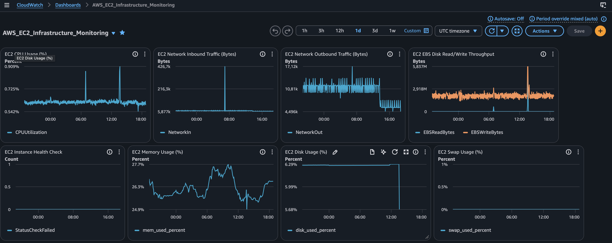

### Three-day overview

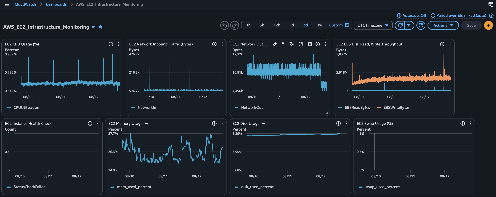

### One-week trend

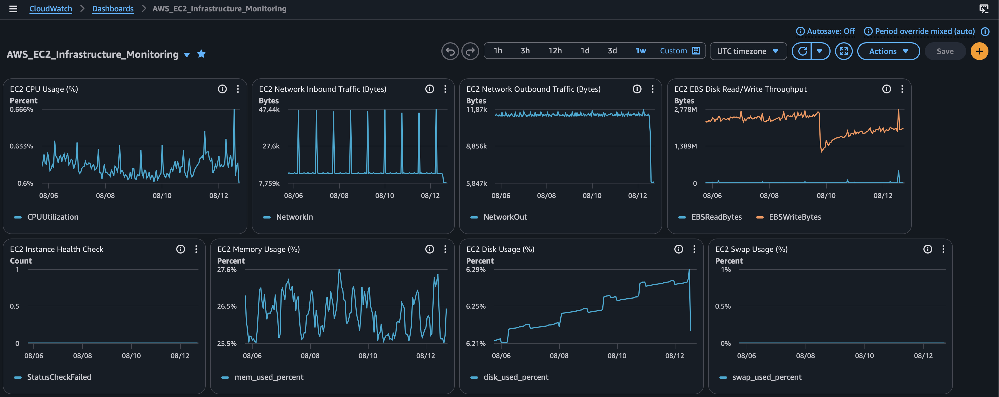

### Post-change confirmation

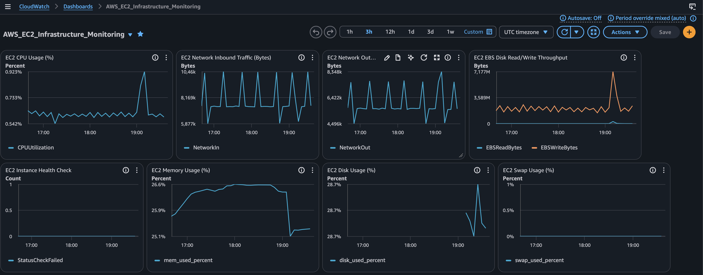

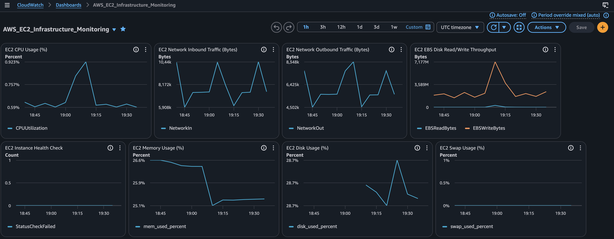

## Focused Agent metrics

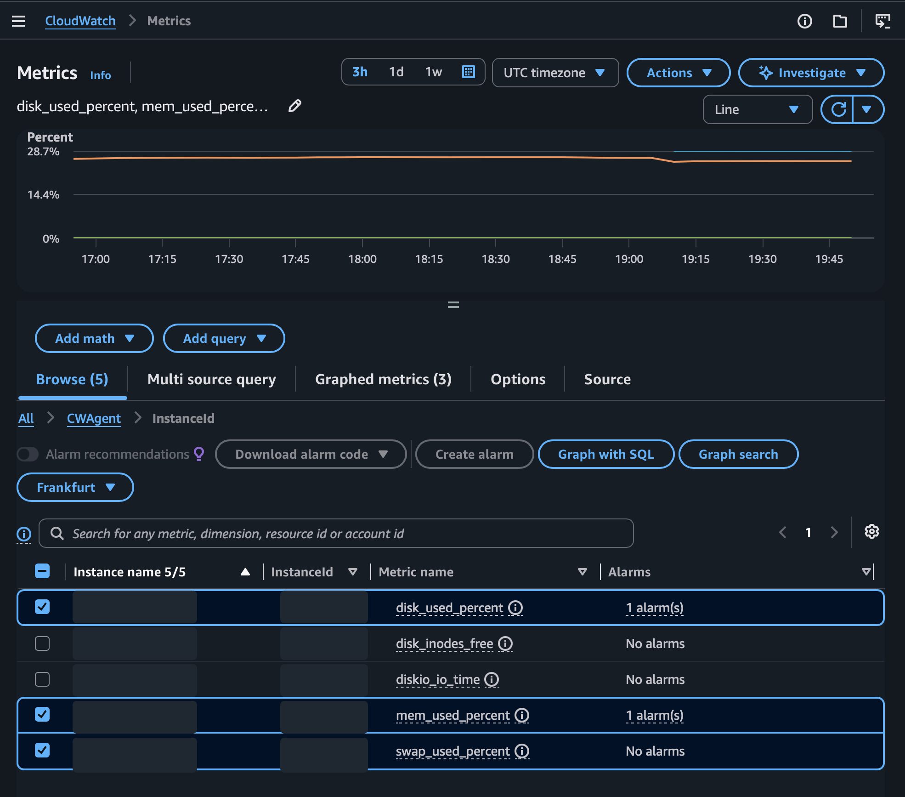

## Alarm state

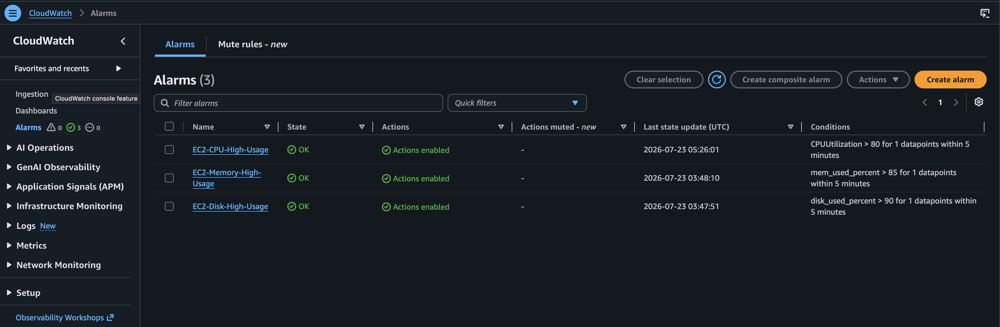

## SNS subscription confirmation

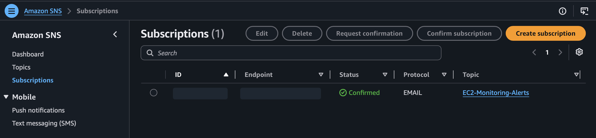

## Controlled notification delivery test

The notification path was exercised without generating CPU load. An operator used the CloudWatch `SetAlarmState` API to place the existing CPU alarm in `ALARM`; the alarm then returned to `OK` when CloudWatch evaluated the real metric. The evidence below proves the alert delivery and the recorded transition, but does not represent a production incident or a real threshold breach.

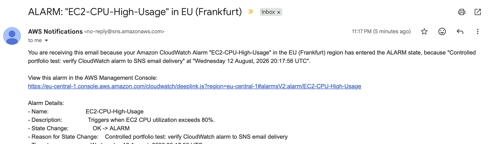

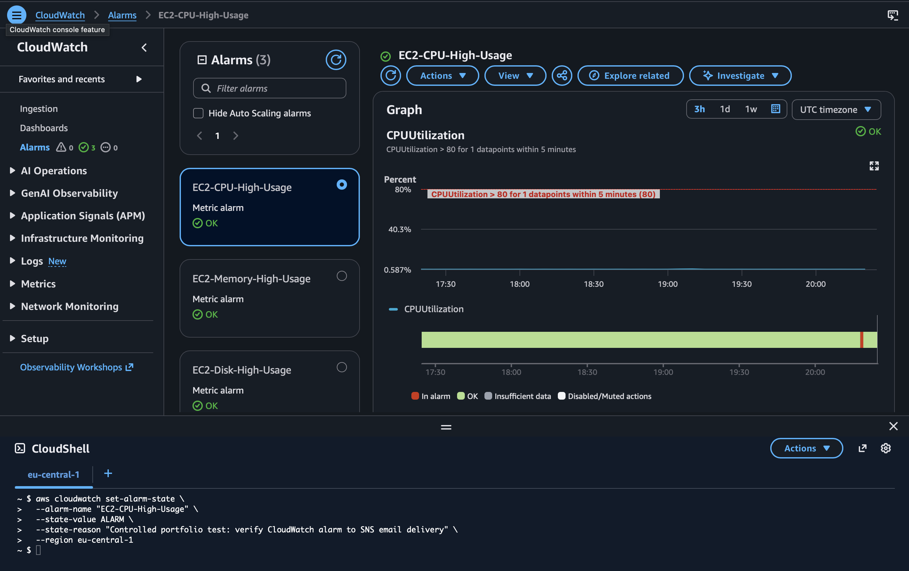

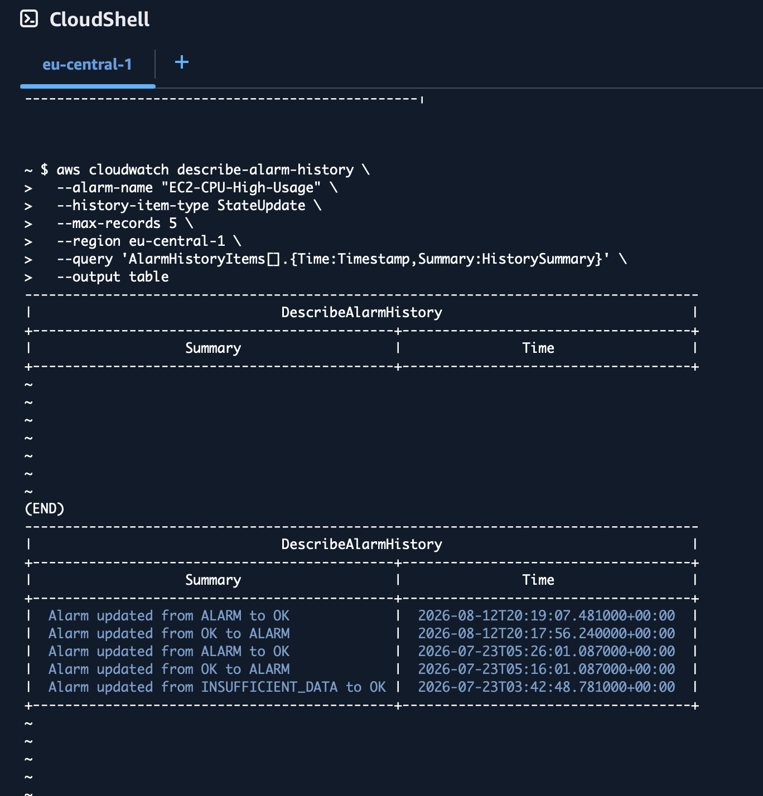

## Redaction and export rules

Crop or mask account IDs, instance IDs, topic ARNs, public IPs, email addresses, billing information, browser tabs, and unrelated resources. Do not publish support cases, credit details, credentials, or raw dashboard exports.

After validating a live dashboard, follow [`dashboards/exported/README.md`](../dashboards/exported/README.md) to save a local export. Keep the raw export untracked; publish only a sanitized copy when it adds real explanatory value.

## Evidence boundary

The dashboard, metric, alarm, and SNS set demonstrates that the monitoring path was configured and observed. The controlled test proves delivery of one `ALARM` notification through the configured SNS subscription. It does not prove that a real workload exceeded the threshold, that a production incident was handled end-to-end, or that a cost reduction was already realized.
